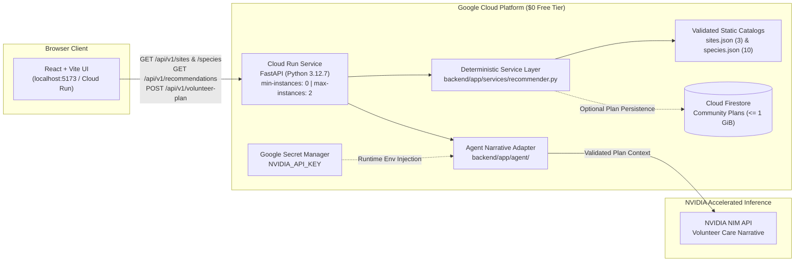

# CanopyCrew System Architecture (`ARCHITECTURE.md`)

| Metadata | Value |
| :--- | :--- |
| **Document Owner** | **Alice** (Cloud Engineering Lane) |
| **UN SDG Alignment** | **UN SDG 11** (Sustainable Cities and Communities — **Target 11.7**: Universal access to safe, inclusive, green public spaces) |
| **Municipal Standards** | *Portaria SVMA nº 26/2024*, *BioSampa (5ª Edição)*, and *Plano Municipal de Arborização Urbana (PMAU)* |
| **Runtime & Cloud Stack** | Python `3.12.7` / FastAPI, React + Vite, **Google Cloud** (Cloud Run + Cloud Firestore + Secret Manager), **NVIDIA NIM API** |
| **Spend Policy** | Strictly **`$0` Free Tier** (`--min-instances 0 --max-instances 2`, zero paid SQL databases) |

> **GitHub Web Editor Tip:** Any teammate can view or edit this document directly in the browser without terminal commands by pressing `.` on the CanopyCrew GitHub repository page.

---

## 1. Executive Overview & MVP Scope

**CanopyCrew** is an urban rewilding matchmaker for São Paulo that translates constrained neighborhood planting sites into municipally compliant native Atlantic Forest (*Mata Atlântica*) plant palettes, deterministic 3-year canopy and seedling cost projections, and actionable volunteer maintenance schedules.

### Strict 4-Week MVP Scope Boundaries
To guarantee biological accuracy, municipal legality, and zero cloud spend within the 4-week GCLP x MMC capstone timeline, CanopyCrew enforces strict scope boundaries:
- **In Scope (3 São Paulo Site Archetypes):**
  1. `site-a-sidewalk-strip` — Compact Sidewalk Strip (`< 1.5 m` width, beneath low-voltage Enel distribution wires).
  2. `site-b-sunny-lot` — Sunny Degraded Lot (`20–50 m²`, open wire-free parcel needing rapid pioneer canopy closure).
  3. `site-c-shaded-courtyard` — Shaded Courtyard (`15–30 m²`, low-lux community or school courtyard).
- **In Scope (10 Verified Native Species):** Curated strictly from *Mata Atlântica* flora approved under *Portaria SVMA nº 26/2024*, *BioSampa (5ª Edição)*, and *PMAU*. Exotic or invasive species (*Ficus microcarpa*, *Ligustrum lucidum*, *Eucalyptus*) are permanently excluded.
- **Explicitly Out of Scope:** Dynamic satellite/GIS parcel mapping, paid relational databases (Cloud SQL / managed PostgreSQL), and native iOS/Android mobile apps.

---

## 2. Cloud & AI Platform Roles (Google Cloud + NVIDIA NIM)

CanopyCrew combines **Google Cloud** serverless infrastructure and **NVIDIA NIM** generative inference while enforcing a hard architectural boundary between **deterministic botanical/cost logic** and **LLM narrative synthesis**:

| Platform / Component | Product Feature Powered | Guardrail & `$0` Quota Limit |
| :--- | :--- | :--- |
| **Google Cloud Run** | Hosts the containerized Python `3.12.7` FastAPI backend (`recommender.py` botanical filtering, wire-safety enforcement, and seedling cost/canopy math) and static SPA delivery. | Serverless scale-to-zero (`--allow-unauthenticated --min-instances 0 --max-instances 2`); well within the **2 million requests/month** Free Tier. |
| **Google Cloud Firestore** | Persists saved community `VolunteerPlanResponse` records and shared neighborhood care checklists without paid SQL instances. | Document-store Free Tier (**max 1 GiB storage**, 50k reads / 20k writes per day); zero paid SQL databases. |
| **Google Secret Manager** | Injects `NVIDIA_API_KEY` into the Cloud Run runtime environment at container startup, isolating credentials from source code and `.env` files. | Managed by Idris (Cloud Cybersecurity); accessed via least-privilege IAM service account. |
| **NVIDIA NIM API** | Synthesizes accessible, bilingual-friendly natural-language volunteer care narratives (`backend/app/agent/`) from validated species selections and site goals. | Strictly **read-only narrative synthesis**; never permitted to select species, override wire-safety rules, or compute cost/canopy totals. |



---

## 3. Deterministic Python vs. LLM Responsibility Split

A core engineering principle of CanopyCrew is that **LLMs never make compliance or mathematical decisions**:

1. **Deterministic Python (`backend/app/services/recommender.py`):**
   - **Startup Schema Enforcement:** Validates `backend/data/sites.json` and `backend/data/species.json` through Pydantic v2 `TypeAdapter` with `extra="forbid"` and caches verified models in memory (`@lru_cache`).
   - **Hard Wire-Safety Constraint (*Portaria SVMA nº 26/2024* & *PMAU*):** Whenever `site.constraints.overhead_power_lines == True`, `_satisfies_wire_safety()` enforces both:
     - `species.physical_profile.sidewalk_wire_safe == True`
     - `species.physical_profile.mature_height_meters <= 5.0`
   - **Site Suitability Filtering:** Confirms `site_id in species.site_tolerances.suitable_site_ids` before recommending a species or accepting it in a volunteer plan (`HTTP 400` on violation).
   - **Exact Cost & Canopy Math:** Sums `unit_cost_usd` (rounded to 2 decimals) and `canopy_coverage_m2_at_year_3` (rounded to 1 decimal), and consolidates deduplicated `initial_month`, `maintenance_quarterly`, and `annual` volunteer tasks.
2. **NVIDIA NIM Narrative Layer (`backend/app/agent/`):**
   - Receives only the **already-validated** site archetype, verified species subset, and deterministic totals.
   - Generates an encouraging, plain-language neighborhood planting and stewardship guide tailored for community volunteers.
   - Degrades gracefully to the deterministic structured `consolidated_care_schedule` whenever `NVIDIA_API_KEY` is absent in offline or local test environments.

---

## 4. Repository Structure & 4-Lane Ownership

### Backend Architecture (`backend/`)
```text
backend/
├── app/
│   ├── main.py                  # FastAPI app initialization, router mounting, CORS policy
│   ├── agent/                   # Laurine: NVIDIA NIM prompt templates & narrative synthesis
│   ├── api/routes/
│   │   ├── health.py            # GET /, GET /health, GET /api/v1/health
│   │   ├── sites.py             # GET /api/v1/sites, GET /api/v1/sites/{site_id}
│   │   ├── species.py           # GET /api/v1/species, GET /api/v1/species/{species_id}
│   │   └── plans.py             # GET /api/v1/recommendations, POST /api/v1/volunteer-plan
│   ├── core/
│   │   └── config.py            # pydantic-settings env loader (SecretStr for NVIDIA_API_KEY)
│   ├── schemas/
│   │   └── plan.py              # Pure Pydantic v2 request/response & catalog models
│   └── services/
│       └── recommender.py       # Deterministic wire-safety filter & cost/canopy calculator
├── data/
│   ├── sites.json               # 3 canonical São Paulo urban site archetypes
│   └── species.json             # 10 verified native Atlantic Forest species
├── tests/
│   ├── test_health.py           # Health probe tests
│   └── test_endpoints.py        # Site, recommendation, wire-safety & plan math unit tests
├── pytest.ini
└── requirements.txt             # Pinned lightweight Python 3.12.7 dependencies
```

### 4-Lane Team Ownership & 4-Week Delivery Plan

| Lane Owner | Role | Owned Directories & Deliverables | 4-Week Milestone Focus |
| :--- | :--- | :--- | :--- |
| **Alice** | Cloud Engineering | `backend/` (routes, schemas, services, core, data), `docs/ARCHITECTURE.md`, `docs/DATA_SCHEMA.md`, Cloud Run & Firestore | **W1:** Schemas & catalogs -> **W2:** Deterministic endpoints & unit tests -> **W3:** Cloud Run deployment -> **W4:** Load & reliability verification |
| **Laurine** | AI Research / Lead | `frontend/` (React + Vite UI/UX), `backend/app/agent/` (NVIDIA NIM prompt templates) | **W1:** UI wireframes -> **W2:** Site selector & API integration -> **W3:** NVIDIA NIM care narrative integration -> **W4:** UX polish & demo flow |
| **Barbara** | AI Cloud Leader | `docs/PRODUCT_BRIEF.md`, pitch narrative, UN SDG 11.7 impact metrics | **W1:** Problem grounding -> **W2:** Stakeholder & PMAU alignment -> **W3:** Impact metrics synthesis -> **W4:** Final capstone pitch deck |
| **Idris** | Cloud Cybersecurity | GCP IAM, Google Secret Manager, CORS/input hardening, `docs/SECURITY.md` | **W1:** Secret hygiene baseline -> **W2:** IAM & Secret Manager setup -> **W3:** Cloud Run & CORS audit -> **W4:** Final security sign-off |

---

## 5. REST API Surface Summary

All versioned endpoints are mounted under `/api/v1` (configured via `Settings.api_v1_prefix` in `backend/app/core/config.py`). Full JSON payload schemas and field constraints are documented in [`docs/DATA_SCHEMA.md`](./DATA_SCHEMA.md).

| Method | Path | Handler | Status Codes | Purpose |
| :--- | :--- | :--- | :--- | :--- |
| `GET` | `/` | `health.root` | `200` | Root welcome banner (`{"message": "Welcome to CanopyCrew API 🌱"}`). |
| `GET` | `/health` | `health.health` | `200` | Cloud Run liveness/readiness probe (`{"status": "healthy", "app": "CanopyCrew API"}`). |
| `GET` | `/api/v1/health` | `health.health` | `200` | Versioned health check alias for frontend API clients. |
| `GET` | `/api/v1/sites` | `sites.list_sites` | `200` | Returns all 3 verified São Paulo `SiteArchetype` objects. |
| `GET` | `/api/v1/sites/{site_id}` | `sites.retrieve_site` | `200`, `404` | Returns a single `SiteArchetype` by `site_id` or `404` if unknown. |
| `GET` | `/api/v1/species` | `species.list_species` | `200` | Returns all 10 verified native Atlantic Forest `NativeSpecies` objects. |
| `GET` | `/api/v1/species/{species_id}` | `species.retrieve_species` | `200`, `404` | Returns a single `NativeSpecies` by `species_id` or `404` if unknown. |
| `GET` | `/api/v1/recommendations?site_id=...` | `plans.recommend_species` | `200`, `404`, `422` | Deterministically filters the 10-species catalog for municipal wire safety and site suitability. |
| `POST` | `/api/v1/volunteer-plan` | `plans.create_volunteer_plan` | `200`, `400`, `404`, `422` | Validates selected species against site rules and computes seedling cost, Year-3 canopy (`m²`), and volunteer care tasks. |

---

## 6. CORS, Security & `$0` Cloud Run Deployment

### CORS & Input Hardening
- **Explicit Allowed Origins (`backend/app/main.py` & `config.py`):**
  - Local Vite development server: `http://localhost:5173` and `http://127.0.0.1:5173` (always preserved even when custom `CORS_ORIGINS` are supplied).
  - Production Google Cloud Run domains via regex: `^https://[a-z0-9-]+(\.[a-z0-9-]+)*\.run\.app$`.
- **Method & Credential Restrictions:** `allow_methods=["GET", "POST", "OPTIONS"]` and `allow_credentials=False`.
- **Secret Isolation:** `Settings.nvidia_api_key` uses Pydantic's `SecretStr` so credentials never leak in stack traces or repr logs. `.env` files are strictly gitignored; production secrets are mounted exclusively from Google Secret Manager.

### Serverless Cloud Run Deployment Template (`$0` Spend Guardrail)
Deployments bind to `PORT` (injected automatically by Cloud Run as `8080`, mapped via `AliasChoices("PORT", "API_PORT")` in `config.py`), run as an unprivileged container user (`appuser`), and enforce zero-instance scale-down in an **Always Free Tier** region (`us-central1`) inside the isolated `canopycrew-sp-mvp` project:

```bash
gcloud run deploy canopycrew-api \
  --source ./backend \
  --project canopycrew-sp-mvp \
  --region us-central1 \
  --platform managed \
  --service-account canopycrew-runtime@canopycrew-sp-mvp.iam.gserviceaccount.com \
  --allow-unauthenticated \
  --min-instances 0 \
  --max-instances 2 \
  --memory 512Mi \
  --cpu 1 \
  --set-env-vars "APP_ENV=production,DEBUG=false" \
  --set-secrets "NVIDIA_API_KEY=canopycrew-nvidia-api-key:latest"
```

### Isolated GCP Project & Least-Privilege Runtime Architecture
- **Live Production URL:** `https://canopycrew-api-sb77peq6bq-uc.a.run.app`
- **Isolated Project Boundary:** `canopycrew-sp-mvp` (dedicated strictly to CanopyCrew MVP workloads, isolated from personal/external GCP projects).
- **Always Free Tier Region:** `us-central1` (eligible for Google Cloud Run's Always Free quota of 2 million requests/month, 180,000 vCPU-seconds, and 360,000 GiB-seconds).
- **Container Runtime Hardening:** `backend/Dockerfile` builds on `python:3.12-slim` and drops root privileges (`USER appuser`) prior to starting `uvicorn`.
- **Service Account Separation:** Cloud Build executes image builds using its dedicated build service agent, while the running container executes under the least-privilege `canopycrew-runtime@canopycrew-sp-mvp.iam.gserviceaccount.com` identity (which holds zero build or artifact-write permissions). See [`docs/SECURITY.md`](./SECURITY.md) for the complete IAM and security specification.
- **Health Probe:** `curl -s https://canopycrew-api-sb77peq6bq-uc.a.run.app/api/v1/health` -> `{"status":"healthy","app":"CanopyCrew API"}`

> **Budget Guardrail:** Never increase `--min-instances` above `0`, never increase `--max-instances` above `2`, and never provision Cloud SQL or paid VPC connectors.

---

## 7. Zero-Install Reproducibility & Verification Commands

### Option A: Zero-Install Browser Setup (GitHub Codespaces)
1. Click **Code -> Codespaces -> Create codespace on `main`** (or your feature branch).
2. `.devcontainer/devcontainer.json` automatically provisions **Python 3.12** + **Node.js 22**, installs `frontend` npm packages and `backend/requirements.txt`, and forwards ports `8000` (FastAPI) and `5173` (Vite).

### Option B: Step-by-Step CLI Verification
Run the deterministic test suite and verify live endpoints from the repository root:

```bash
# 1. Run automated unit and municipal compliance tests (Python 3.12.7)
cd backend
pytest -v

# 2. Start the FastAPI development server on port 8000
uvicorn app.main:app --reload --host 127.0.0.1 --port 8000
```

In a second terminal, verify health, wire-safe filtering, and volunteer plan math:

```bash
# Health check
curl -s http://127.0.0.1:8000/api/v1/health

# Fetch wire-safe recommendations for Compact Sidewalk Strip (returns 5 species <= 5.0 m)
curl -s "http://127.0.0.1:8000/api/v1/recommendations?site_id=site-a-sidewalk-strip"

# Generate a deterministic volunteer plan ($25.50 total, 7.6 m² Year-3 canopy)
curl -s -X POST http://127.0.0.1:8000/api/v1/volunteer-plan \
  -H "Content-Type: application/json" \
  -d '{
    "site_id": "site-a-sidewalk-strip",
    "selected_species_ids": [
      "eugenia-uniflora",
      "calliandra-tweediei",
      "salvia-splendens"
    ]
  }'
```

