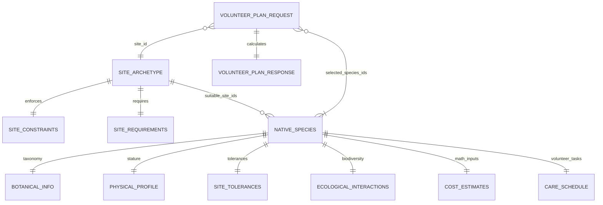

# CanopyCrew Data Schema & API Contracts (`DATA_SCHEMA.md`)

| Metadata | Value |
| :--- | :--- |
| **Document Owner** | **Alice** (Cloud Engineering Lane) |
| **Validation Engine** | **Pydantic v2** (`pydantic==2.14.2`, strict `ConfigDict(extra="forbid")` on all models) |
| **Canonical Datasets** | `backend/data/sites.json` (3 archetypes) & `backend/data/species.json` (10 native species) |
| **Municipal Standards** | *Portaria SVMA nº 26/2024*, *BioSampa (5ª Edição)*, and *Plano Municipal de Arborização Urbana (PMAU)* |
| **Storage Budget** | **`$0` Spend** — Static validated JSON in Git + optional Cloud Firestore (`<= 1 GiB` Free Tier; no paid SQL databases) |

> **GitHub Web Editor Tip:** Press `.` in the GitHub repository view to inspect or update this contract in the browser without local setup.

---

## 1. Data Modeling & Validation Philosophy

CanopyCrew stores its reference botanical and urban site catalogs as version-controlled static JSON files (`backend/data/sites.json` and `backend/data/species.json`) validated at read time by pure Pydantic v2 schemas in `backend/app/schemas/plan.py`.

1. **Zero Unverified Fields (`extra="forbid"`):** Every Pydantic model enforces `ConfigDict(extra="forbid")`. Any unexpected property in JSON seed files or client `POST` bodies immediately raises a validation error (`HTTP 422` on API requests).
2. **Deterministic Legal Compliance:** Every species record encodes explicit municipal citations (`municipal_compliance`), physical stature (`mature_height_meters`), overhead wire compatibility (`sidewalk_wire_safe`), and pre-reviewed site suitability (`suitable_site_ids`).
3. **`$0` Cloud Persistence:** Static reference catalogs require zero database spend. Saved community volunteer plans map 1:1 from `VolunteerPlanResponse` into Google Cloud Firestore (`volunteer_plans` collection, capped within the **1 GiB Free Tier**) while **NVIDIA NIM** (`backend/app/agent/`) consumes the validated response purely to synthesize natural-language volunteer care narratives.



---

## 2. Urban Site Archetype Schema (`backend/data/sites.json`)

### 2.1 Pydantic Models (`SiteArchetype`, `SiteConstraints`, `SiteRequirements`)

#### `SiteArchetype`
| Field | Type | Validation | Description |
| :--- | :--- | :--- | :--- |
| `site_id` | `string` | `min_length=1` | Canonical slug identifier (strictly one of the 3 MVP site IDs). |
| `name` | `string` | `min_length=1` | Human-readable São Paulo archetype title. |
| `archetype_label` | `string` | `min_length=1` | Short UI badge label (`Sidewalk Strip`, `Sunny Lot`, `Shaded Courtyard`). |
| `description` | `string` | `min_length=1` | Urban morphology, microclimate, and infrastructure context. |
| `typical_dimensions` | `string` | `min_length=1` | Typical spatial footprint (`< 1.5 m width`, `20–50 m²`, `15–30 m²`). |
| `sunlight_exposure` | `Literal` | `"full_sun" \| "partial_shade" \| "partial_to_full_shade"` | Dominant site solar regime. |
| `constraints` | `SiteConstraints` | Required nested object | Physical, soil, and utility-wire constraints. |
| `requirements` | `SiteRequirements` | Required nested object | Botanical and municipal eligibility flags. |
| `ecological_goals` | `list[string]` | `min_length=1` | UN SDG 11.7 and local biodiversity restoration targets. |

#### `SiteConstraints`
| Field | Type | Validation | Description |
| :--- | :--- | :--- | :--- |
| `max_width_meters` | `float \| null` | `gt=0` when set | Maximum planting strip width in meters (`1.5` for sidewalks; `null` for lots/courtyards). |
| `min_area_m2` | `float` | `gt=0` | Minimum typical site area (`m²`). |
| `max_area_m2` | `float` | `gt=0` | Maximum typical site area (`m²`). |
| `overhead_power_lines` | `bool` | Required | When `true`, triggers hard `sidewalk_wire_safe == true` and `mature_height_meters <= 5.0` filtering. |
| `max_mature_height_meters` | `float` | `gt=0` | Maximum mature plant height permitted on the site (`m`). |
| `impervious_surroundings` | `bool` | Required | Whether concrete/asphalt surrounds the planting pocket. |
| `soil_compaction_level` | `Literal` | `"low" \| "moderate" \| "high"` | Baseline urban soil compaction severity. |

#### `SiteRequirements`
| Field | Type | Validation | Description |
| :--- | :--- | :--- | :--- |
| `sidewalk_wire_safe` | `bool` | Required | Requires species cleared for overhead distribution wires and narrow curbs. |
| `non_invasive_roots` | `bool` | Required | Requires root architectures that will not heave sidewalks or courtyard walls. |
| `low_lux_tolerance` | `bool` | Default `false` | Requires shade-tolerant understory physiology. |
| `pioneer_priority` | `bool` | Default `false` | Prioritizes fast-closing pioneer canopy nucleators. |
| `avifauna_support_priority` | `bool` | Default `false` | Prioritizes zoochoric fruit and nectar resources for urban birds. |
| `municipal_reference` | `string` | `min_length=1` | Governing São Paulo municipal legal instruments. |

### 2.2 Canonical 3 Site Archetypes Reference Table

| `site_id` | `archetype_label` | Dimensions | Sunlight | `overhead_power_lines` | Max Height | Eligible Species Count |
| :--- | :--- | :--- | :--- | :--- | :--- | :--- |
| `site-a-sidewalk-strip` | `Sidewalk Strip` | `< 1.5 m width` (`1.5–6.0 m²`) | `full_sun` | `true` | `5.0 m` | **5** wire-safe species |
| `site-b-sunny-lot` | `Sunny Lot` | `20–50 m²` | `full_sun` | `false` | `12.0 m` | **9** sun-tolerant species |
| `site-c-shaded-courtyard` | `Shaded Courtyard` | `15–30 m²` | `partial_to_full_shade` | `false` | `8.0 m` | **5** low-lux tolerant species |

---

## 3. Native Species Catalog Schema (`backend/data/species.json`)

### 3.1 Ecological & Legal Hard Guardrails
- **100% Native *Mata Atlântica* Catalog:** Every entry in `species.json` is verified against *Portaria SVMA nº 26/2024*, *BioSampa (5ª Edição)*, and *PMAU*.
- **Permanent Exotic/Invasive Ban:** Species belonging to *Ficus* (e.g., *Ficus microcarpa*), *Ligustrum* (e.g., *Ligustrum lucidum*), or *Eucalyptus* must never be added to `species.json` or recommended by any service/agent (enforced by `test_species_seed_catalog_integrity` in `backend/tests/test_endpoints.py`).
- **Hard Wire-Safety Rule:** If `overhead_power_lines == true` on a requested site, `recommender.py` rejects any species where `sidewalk_wire_safe != true` or `mature_height_meters > 5.0`.

### 3.2 Pydantic Models (`NativeSpecies` & Nested Sub-Models)

| Sub-Model | Field | Type | Validation / Allowed Values |
| :--- | :--- | :--- | :--- |
| **`NativeSpecies`** (root) | `species_id` | `string` | `min_length=1` (kebab-case scientific binomial slug) |
| **`BotanicalInfo`** (`botanical`) | `scientific_name` | `string` | Binomial scientific name (`min_length=1`) |
| | `common_name_pt` | `string` | Brazilian Portuguese popular name (`min_length=1`) |
| | `common_name_en` | `string` | English common name (`min_length=1`) |
| | `family` | `string` | Botanical family (`min_length=1`) |
| | `biome_origin` | `string` | Native Atlantic Forest provenance (`min_length=1`) |
| | `municipal_compliance` | `list[string]` | Citations from *Portaria SVMA nº 26/2024*, *BioSampa*, *PMAU* (`min_length=1`) |
| | `successional_group` | `Literal` | `"pioneer" \| "early_secondary" \| "late_secondary" \| "understory_herbaceous"` |
| **`PhysicalProfile`** (`physical_profile`) | `growth_habit` | `Literal` | `"small_tree" \| "medium_tree" \| "large_pioneer_tree" \| "woody_shrub" \| "rosette_bromeliad" \| "perennial_subshrub"` |
| | `mature_height_meters` | `float` | `gt=0` (must be `<= 5.0` for wired sidewalk strips) |
| | `canopy_spread_meters` | `float` | `gt=0` |
| | `root_system` | `Literal` | `"non_aggressive_pivoting" \| "fibrous_contained" \| "fasciculate_shallow" \| "extensive_structural"` |
| | `sidewalk_wire_safe` | `bool` | `true` only when safe beneath overhead wires and alongside sidewalks |
| **`SiteTolerances`** (`site_tolerances`) | `sunlight` | `list[Literal]` | Subset of `["full_sun", "partial_shade", "full_shade", "partial_to_full_shade"]` |
| | `low_lux_tolerant` | `bool` | Tolerates shaded courtyard light levels |
| | `drought_tolerant` | `bool` | Tolerates seasonal dry winter spells |
| | `compacted_soil_tolerant` | `bool` | Tolerates compacted urban subsoil |
| | `suitable_site_ids` | `list[string]` | Verified subset of `site-a-sidewalk-strip`, `site-b-sunny-lot`, `site-c-shaded-courtyard` |
| **`EcologicalInteractions`** (`ecological_interactions`) | `pollinators` | `list[string]` | Native bees, hummingbirds, butterflies, or wind (`min_length=1`) |
| | `seed_dispersers_avifauna` | `list[string]` | Native urban avifauna or dispersal guild (`min_length=1`) |
| | `ecological_role` | `string` | Functional urban ecosystem summary (`min_length=1`) |
| **`CostEstimates`** (`estimates`) | `growth_rate_cm_per_year` | `int` | `gt=0` (annual vertical growth rate in `cm/year`) |
| | `canopy_coverage_m2_at_year_3` | `float` | `gt=0` (projected Year-3 crown area in `m²`) |
| | `unit_cost_usd` | `float` | `gt=0` (estimated nursery seedling cost in USD) |
| **`CareSchedule`** (`volunteer_care_schedule`) | `initial_month` | `list[CareTask]` | Establishment tasks (`task`, `frequency`, `notes`) |
| | `maintenance_quarterly` | `list[CareTask]` | Recurring quarterly stewardship tasks (`task`, `frequency`, `notes`) |
| | `annual` | `list[CareTask]` | Yearly pruning, propagation, or inspection tasks (`task`, `frequency`, `notes`) |

### 3.3 Canonical 10 Verified Native Species Matrix

| `species_id` | Portuguese Name (*Scientific Name*) | Habit | Mature Height | Wire Safe | Unit Cost (USD) | Year-3 Canopy (`m²`) | Suitable Archetypes |
| :--- | :--- | :--- | :--- | :--- | :--- | :--- | :--- |
| `eugenia-uniflora` | Pitangueira (*Eugenia uniflora*) | `small_tree` | `5.0 m` | `true` | `$12.50` | `4.2` | `site-a`, `site-b`, `site-c` |
| `schinus-terebinthifolia` | Aroeira-pimenteira (*Schinus terebinthifolia*) | `medium_tree` | `7.0 m` | `false` | `$11.00` | `8.5` | `site-b` |
| `pleroma-mutabile` | Manacá-da-serra (*Pleroma mutabile*) | `medium_tree` | `6.0 m` | `false` | `$14.00` | `6.8` | `site-b`, `site-c` |
| `cecropia-pachystachya` | Embaúba-branca (*Cecropia pachystachya*) | `large_pioneer_tree` | `10.0 m` | `false` | `$10.50` | `12.5` | `site-b` |
| `calliandra-tweediei` | Esponjinha-vermelha (*Calliandra tweediei*) | `woody_shrub` | `2.5 m` | `true` | `$8.50` | `2.6` | `site-a`, `site-b` |
| `campomanesia-phaea` | Cambuci (*Campomanesia phaea*) | `small_tree` | `4.5 m` | `true` | `$16.00` | `3.0` | `site-b`, `site-c` |
| `psidium-cattleianum` | Araçá-amarelo (*Psidium cattleianum*) | `small_tree` | `4.0 m` | `true` | `$11.50` | `3.8` | `site-a`, `site-b` |
| `myrcia-glabra` | Cabeludinha / Cambucá-mirim (*Myrcia glabra*) | `woody_shrub` | `3.0 m` | `true` | `$14.50` | `2.2` | `site-c` |
| `bromelia-antiacantha` | Gravatá (*Bromelia antiacantha*) | `rosette_bromeliad` | `0.9 m` | `true` | `$6.50` | `1.0` | `site-a`, `site-b` |
| `salvia-splendens` | Cardeal-do-brejo / Sálvia-vermelha (*Salvia splendens*) | `perennial_subshrub` | `1.2 m` | `true` | `$4.50` | `0.8` | `site-a`, `site-b`, `site-c` |

---

## 4. REST Endpoint Contracts & Example Payloads

### 4.1 Health Probes — `GET /health` & `GET /api/v1/health`
- **Response (`200 OK`):**
```json
{
  "status": "healthy",
  "app": "CanopyCrew API"
}
```

### 4.2 Site Archetypes — `GET /api/v1/sites` & `GET /api/v1/sites/{site_id}`
- **`GET /api/v1/sites` (`200 OK`):** Returns `list[SiteArchetype]` (all 3 São Paulo site archetypes).
- **`GET /api/v1/sites/site-a-sidewalk-strip` (`200 OK`):** Returns a single `SiteArchetype` object.
- **Error (`404 Not Found`):**
```json
{
  "detail": "Unknown site archetype 'site-z-rooftop'."
}
```

### 4.3 Native Species Catalog — `GET /api/v1/species` & `GET /api/v1/species/{species_id}`
- **`GET /api/v1/species` (`200 OK`):** Returns `list[NativeSpecies]` (all 10 verified native *Mata Atlântica* species in a single request for catalogue views).
- **`GET /api/v1/species/eugenia-uniflora` (`200 OK`):** Returns a single `NativeSpecies` object.
- **Error (`404 Not Found`):**
```json
{
  "detail": "Unknown native species 'ficus-microcarpa'."
}
```

### 4.4 Deterministic Species Recommendations — `GET /api/v1/recommendations`
- **Query Parameter:** `site_id` (required `string`, `min_length=1`, `max_length=64`, `pattern=r"^[a-z0-9-]+$"`).
- **Deterministic Filtering Rules (`recommender.get_recommendations`):**
  1. Looks up `site_id` (`404` if not one of the 3 verified archetypes).
  2. Rejects any species failing `_satisfies_wire_safety(site, species)`.
  3. Returns all remaining species where `site_id in species.site_tolerances.suitable_site_ids` as `list[NativeSpecies]`.
- **Expected Species IDs per Archetype:**
  - `site-a-sidewalk-strip` (**5**): `eugenia-uniflora`, `calliandra-tweediei`, `psidium-cattleianum`, `bromelia-antiacantha`, `salvia-splendens`
  - `site-b-sunny-lot` (**9**): `eugenia-uniflora`, `schinus-terebinthifolia`, `pleroma-mutabile`, `cecropia-pachystachya`, `calliandra-tweediei`, `campomanesia-phaea`, `psidium-cattleianum`, `bromelia-antiacantha`, `salvia-splendens`
  - `site-c-shaded-courtyard` (**5**): `eugenia-uniflora`, `pleroma-mutabile`, `campomanesia-phaea`, `myrcia-glabra`, `salvia-splendens`

### 4.5 Volunteer Plan Calculation — `POST /api/v1/volunteer-plan` & `POST /api/v1/volunteer-plan/narrative`

- **Optional Query Parameter on `POST /api/v1/volunteer-plan`:** `include_narrative` (`boolean`, default `false`). When `true` (or when calling `POST /api/v1/volunteer-plan/narrative`), `care_narrative` is populated via `generate_volunteer_care_narrative()` using NVIDIA NIM (`nvidia/nemotron-3-ultra-550b-a55b`, bounded by `nim_daily_call_cap = 100` calls/day) with deterministic English + Brazilian Portuguese botanical fallback (`build_fallback_narrative()`).

#### Request Body (`VolunteerPlanRequest`)
| Field | Type | Validation | Description |
| :--- | :--- | :--- | :--- |
| `site_id` | `string` | `min_length=1`, `max_length=64`, `pattern=r"^[a-z0-9-]+$"`, `extra="forbid"` | Target São Paulo site archetype ID. |
| `selected_species_ids` | `list[CatalogSlugStr]` | `min_length=1`, `max_length=10` items (each `1..64` chars, `^[a-z0-9-]+$`), `extra="forbid"` | Non-empty array of `species_id` slugs chosen for planting. |
| `volunteer_name` | `string \| null` | Optional (`default=None`), `max_length=100`, `extra="forbid"` | Optional volunteer or neighborhood group name. |

```json
{
  "site_id": "site-a-sidewalk-strip",
  "selected_species_ids": [
    "eugenia-uniflora",
    "calliandra-tweediei",
    "salvia-splendens"
  ]
}
```

#### Deterministic Calculation Rules (`recommender.calculate_volunteer_plan`)
- `selected_species_count`: `len(selected_species)` (counts every seedling entry in `selected_species_ids`).
- `total_seedling_cost_usd`: `round(sum(sp.estimates.unit_cost_usd for sp in selected_species), 2)`.
- `projected_canopy_m2_year_3`: `round(sum(sp.estimates.canopy_coverage_m2_at_year_3 for sp in selected_species), 1)`.
- `consolidated_care_schedule`: Groups tasks into `initial_month`, `maintenance_quarterly`, and `annual`, deduplicating task templates by `species_id` and tagging each task with `"species_id"` and `"species": "<common_name_pt> (<scientific_name>)"`.

#### Response Body (`VolunteerPlanResponse` — `200 OK`)
```json
{
  "site_id": "site-a-sidewalk-strip",
  "total_seedling_cost_usd": 25.5,
  "projected_canopy_m2_year_3": 7.6,
  "selected_species_count": 3,
  "consolidated_care_schedule": {
    "initial_month": [
      {
        "species_id": "eugenia-uniflora",
        "species": "Pitangueira (Eugenia uniflora)",
        "task": "Deep establishment watering (10 L per seedling) and organic mulch ring check",
        "frequency": "Twice weekly for first 4 weeks",
        "notes": "Keep mulch 5 cm clear of the trunk collar to prevent rot."
      }
    ],
    "maintenance_quarterly": [
      {
        "species_id": "eugenia-uniflora",
        "species": "Pitangueira (Eugenia uniflora)",
        "task": "Top-dress planting basin with 2 kg cured compost and remove invasive grasses",
        "frequency": "Every 3 months",
        "notes": "Hand-pull weeds inside the 60 cm permeable collar; never use herbicides."
      }
    ],
    "annual": [
      {
        "species_id": "eugenia-uniflora",
        "species": "Pitangueira (Eugenia uniflora)",
        "task": "Light formative crown-lifting prune below 1.8 m pedestrian clearance",
        "frequency": "Once yearly (late winter — August)",
        "notes": "Follow PMAU pruning standards; never top the central leader."
      }
    ]
  },
  "care_narrative": null
}
```

#### Error Status Codes for `POST /api/v1/volunteer-plan`
| HTTP Status | Trigger Condition | Example `detail` |
| :--- | :--- | :--- |
| `400 Bad Request` | Unknown or banned species ID (e.g., `ficus-microcarpa`) | `"Species 'ficus-microcarpa' is not in the verified native Atlantic Forest catalog."` |
| `400 Bad Request` | Tall/wire-unsafe species selected on a wired site (`cecropia-pachystachya` on `site-a-sidewalk-strip`) | `"Species 'cecropia-pachystachya' violates overhead power-line safety constraints for site 'site-a-sidewalk-strip'."` |
| `400 Bad Request` | Species unsuitable for site microclimate (e.g., `myrcia-glabra` on `site-b-sunny-lot`) | `"Species 'myrcia-glabra' is not ecologically suitable for site 'site-b-sunny-lot'."` |
| `404 Not Found` | `site_id` is not one of the 3 verified archetypes | `"Unknown site archetype 'nonexistent-site'."` |
| `422 Unprocessable Entity` | Empty `selected_species_ids` (`[]`), missing fields, or unexpected extra properties (`extra="forbid"`) | Standard FastAPI / Pydantic v2 validation error array |

---

## 5. Cloud Firestore & NVIDIA NIM Extension Contract

To support persistence and AI care narratives without breaking frontend integration or deterministic guarantees:
- **Cloud Firestore Document (`volunteer_plans/{plan_id}`):** Stores the validated `VolunteerPlanResponse` payload plus server-generated `created_at` (ISO-8601 UTC timestamp) within the **`$0` Free Tier (`<= 1 GiB` storage)**.
- **NVIDIA NIM Narrative Integration (`backend/app/agent/`):** Consumes `SiteArchetype` + `VolunteerPlanResponse` as read-only prompt context to return an optional natural-language `care_narrative` string while keeping `total_seedling_cost_usd`, `projected_canopy_m2_year_3`, and species eligibility strictly governed by `recommender.py`.

