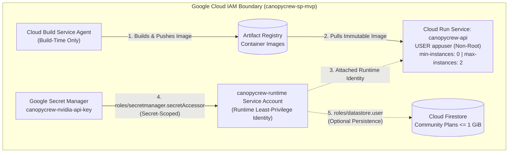

# CanopyCrew Cloud Security & Compliance Specification (`SECURITY.md`)

| Metadata | Value |
| :--- | :--- |
| **Document Owner** | **Idris** (Cloud Cybersecurity Lane) / **Alice** (Cloud Engineering Lane) |
| **UN SDG Alignment** | **UN SDG 11** (Sustainable Cities and Communities — **Target 11.7**: Universal access to safe, inclusive, green public spaces) |
| **Municipal & Legal Standards** | *Portaria SVMA nº 26/2024*, *BioSampa (5ª Edição)*, and *Plano Municipal de Arborização Urbana (PMAU)* |
| **Cloud & AI Stack** | Python `3.12.7` / FastAPI, **Google Cloud** (`canopycrew-sp-mvp`: Cloud Run, Secret Manager, Firestore), **NVIDIA NIM API** |
| **Financial & Security Posture** | **Zero Hardcoded Secrets**, **Least-Privilege IAM**, **Non-Root Container Runtime**, **`$0` Always Free Tier** |

> **GitHub Web Editor Tip:** Any teammate can view or edit this document directly in the browser without terminal commands by pressing `.` on the CanopyCrew GitHub repository page.

---

## 1. Security Executive Summary & Threat Model

**CanopyCrew** helps São Paulo neighborhood volunteers transform constrained urban spaces (**Sidewalk Strip `< 1.5 m`**, **Sunny Lot `20–50 m²`**, and **Shaded Courtyard `15–30 m²`**) using **10 verified native Atlantic Forest (*Mata Atlântica*) species**. Because the platform exposes a public REST API (`--allow-unauthenticated`) and integrates generative AI (**NVIDIA NIM**) with municipal infrastructure safety rules, our security architecture enforces five defense-in-depth pillars:

1. **Project & Billing Blast-Radius Isolation:** Dedicated Google Cloud project (`canopycrew-sp-mvp`) deployed in an Always Free Tier region (`us-central1`) with strict serverless auto-scaling caps (`--min-instances 0 --max-instances 2`).
2. **IAM Least-Privilege & Identity Separation:** Strict separation between build-time identities (Cloud Build) and the unprivileged Cloud Run runtime service account (`canopycrew-runtime`), eliminating the default Compute Engine service account.
3. **Secret Hygiene & Runtime Injection:** Zero plaintext credentials in code or Git history; `NVIDIA_API_KEY` is masked in memory via Pydantic `SecretStr` and injected at container startup from **Google Secret Manager**.
4. **Input Validation, CORS Lockdown & Non-Root Container Hardening:** All request and catalog payloads enforce `ConfigDict(extra="forbid")` in Pydantic v2, CORS is restricted to `http://localhost:5173` and `https://*.run.app` (`allow_credentials=False`), and the container drops root privileges (`USER appuser`).
5. **AI Safety & Municipal Compliance Boundary:** **NVIDIA NIM** is restricted strictly to synthesizing natural-language volunteer care narratives (`backend/app/agent/`). All botanical filtering, exotic species bans, overhead wire-safety checks (`<= 5.0 m`), and seedling cost/canopy math execute in **deterministic Python** (`backend/app/services/recommender.py`).

---

## 2. Project Isolation & IAM Least-Privilege Architecture

### 2.1 Dedicated Google Cloud Project (`canopycrew-sp-mvp`)
CanopyCrew runs in a standalone Google Cloud project (`canopycrew-sp-mvp`) rather than sharing multi-tenant or personal development projects. This guarantees:
- **IAM Boundary Isolation:** Service accounts and APIs enabled for CanopyCrew cannot access buckets, Vertex AI endpoints, or databases in any other project.
- **Cost & Quota Containment:** Cloud Run scales to zero (`--min-instances 0`) and is capped at `--max-instances 2` with `512Mi` memory and `1` vCPU in `us-central1` (Google Cloud Run Always Free Tier: 2M requests/month free).

### 2.2 Separation of Build vs. Runtime Service Accounts
A common cloud security anti-pattern is running public containers under the default Compute Engine service account (`<project-number>-compute@developer.gserviceaccount.com`, which often holds broad `Editor` permissions) or granting container-registry write permissions to the runtime identity.

CanopyCrew strictly separates **build-time** and **runtime** principals:

| Principal / Identity | Scope | Granted IAM Roles | Explicitly Denied / Excluded Capabilities |
| :--- | :--- | :--- | :--- |
| **Cloud Run Runtime Identity**<br/>`canopycrew-runtime@canopycrew-sp-mvp.iam.gserviceaccount.com` | Attached to `canopycrew-api` Cloud Run revision via `--service-account` | • `roles/secretmanager.secretAccessor` (scoped solely to `canopycrew-nvidia-api-key`)<br/>• `roles/datastore.user` (optional, for `<= 1 GiB` Firestore community plans) | **No** `cloudbuild.builds.builder`, **no** `artifactregistry.writer`, **no** `storage.admin`, and **no** project-wide `Editor` or `Owner` roles. |
| **Cloud Build Service Agent**<br/>Managed Google Cloud Build identity | Executes only during `gcloud run deploy --source ./backend` | • `roles/artifactregistry.writer`<br/>• `roles/logging.logWriter` | Never attached to the public-facing Cloud Run container at runtime. |



### 2.3 Keyless Authentication, ADC & Service Account Impersonation
In compliance with Google Cloud IAM best practices, CanopyCrew **never generates or downloads static Service Account JSON keys** (`gcloud iam service-accounts keys list --managed-by=user` is strictly `[]`):
- **Production (Cloud Run Metadata Server):** `canopycrew-runtime@canopycrew-sp-mvp.iam.gserviceaccount.com` is attached directly to the Cloud Run revision. Short-lived OAuth 2.0 / OIDC tokens are minted automatically by the Cloud Run metadata server with zero static key files.
- **Local Development (Application Default Credentials & Impersonation):** Developers authenticate interactively via `gcloud auth application-default login` (ADC) or use short-lived Service Account Impersonation (`--impersonate-service-account=canopycrew-runtime@canopycrew-sp-mvp.iam.gserviceaccount.com`) rather than distributing JSON key files.
- **CI/CD & External Workloads:** Any automated deployment from GitHub Actions must use **Workload Identity Federation (WIF)** to exchange short-lived OIDC tokens rather than storing long-lived service account keys in repository secrets.

### 2.4 Least-Privilege Provisioning Commands
```bash
# 1. Create the dedicated runtime service account (zero default roles, zero user-managed keys)
gcloud iam service-accounts create canopycrew-runtime \
  --display-name="CanopyCrew Cloud Run Runtime Identity" \
  --project=canopycrew-sp-mvp \
  --quiet

# 2. Grant secretAccessor ONLY on the specific NVIDIA_API_KEY secret (not project-wide)
gcloud secrets add-iam-policy-binding canopycrew-nvidia-api-key \
  --member="serviceAccount:canopycrew-runtime@canopycrew-sp-mvp.iam.gserviceaccount.com" \
  --role="roles/secretmanager.secretAccessor" \
  --project=canopycrew-sp-mvp \
  --quiet

# 3. Verify zero user-managed JSON keys exist on the runtime service account
gcloud iam service-accounts keys list \
  --iam-account=canopycrew-runtime@canopycrew-sp-mvp.iam.gserviceaccount.com \
  --managed-by=user \
  --project=canopycrew-sp-mvp \
  --format="json"
```

---

## 3. Secret Management & Credential Hygiene

CanopyCrew enforces a **Zero Hardcoded Secrets** policy across all four lanes:

1. **Repository & Build Context Exclusion:**
   - Root `.gitignore`, `backend/.dockerignore`, and `backend/.gcloudignore` explicitly block `.env`, `.env.*`, `*.pem`, and service account JSON keys from ever entering Git history or container image layers.
   - Only `.env.example` (containing empty placeholder keys) is tracked in Git.
2. **In-Memory Masking via Pydantic `SecretStr` (`backend/app/core/config.py`):**
   - `Settings.nvidia_api_key` is typed as `SecretStr | None = Field(default=None, validation_alias="NVIDIA_API_KEY")`.
   - If a configuration object is logged or serialized in an exception traceback, Pydantic outputs `SecretStr('**********')` instead of leaking the raw API key.
   - The helper method `Settings.has_nvidia_api_key` safely checks whether a non-empty key is configured without exposing the secret string to caller modules.
3. **Google Secret Manager Runtime Injection:**
   - In production on Cloud Run, `NVIDIA_API_KEY` is mounted as an environment variable directly from Google Secret Manager (`--set-secrets="NVIDIA_API_KEY=canopycrew-nvidia-api-key:latest"`) at container startup.
   - In local development or CI test runs (`pytest -v`), `NVIDIA_API_KEY` is omitted and the application operates deterministically without external network calls.

---

## 4. Application, API & Container Hardening

### 4.1 Strict Pydantic v2 Input Sanitization (`extra="forbid"`)
Every request and response model in [`backend/app/schemas/plan.py`](../backend/app/schemas/plan.py) enforces `model_config = ConfigDict(extra="forbid")`:
- **Mass-Assignment & Payload Pollution Prevention:** Any unexpected JSON property sent to `POST /api/v1/volunteer-plan` is rejected immediately at the FastAPI boundary with `HTTP 422 Unprocessable Entity`.
- **Type & Bounds Validation:**
  - `site_id` and `selected_species_ids` require non-empty strings (`Field(min_length=1)`), and `selected_species_ids` must contain at least one element.
  - Startup catalog loaders (`load_sites()` and `load_species()` in `backend/app/services/recommender.py`) validate `backend/data/sites.json` and `backend/data/species.json` against strict `Literal` enums and numeric bounds (`gt=0`) before serving traffic.

### 4.2 CORS Lockdown (`backend/app/main.py` & `backend/app/core/config.py`)
Cross-Origin Resource Sharing is restricted to prevent unauthorized third-party sites from abusing the API:
- **Explicit Allowed Origins:** `http://localhost:5173` and `http://127.0.0.1:5173` (local Vite dev server).
- **Production Origin Regex:** `^https://[a-z0-9-]+(\.[a-z0-9-]+)*\.run\.app$` (permits only HTTPS Google Cloud Run deployments).
- **Restricted HTTP Verbs & Credentials:** `allow_methods=["GET", "POST", "OPTIONS"]` (blocks `PUT`, `PATCH`, `DELETE`) and `allow_credentials=False` (no cookies or ambient browser credentials accepted).

### 4.3 Non-Root Container Execution (`backend/Dockerfile`)
The production container image (`backend/Dockerfile`) follows container security best practices:
- Built on minimal `python:3.12-slim` with `pip install --no-cache-dir` and pinned dependencies in `backend/requirements.txt`.
- Creates a dedicated system group and user (`appgroup` / `appuser`) with `/usr/sbin/nologin` and no home directory.
- Chowns `/app/app` and `/app/data` to `appuser:appgroup` and switches to `USER appuser` before launching `uvicorn`.
- Excludes `tests/`, `.pytest_cache/`, `.venv/`, and `.env*` via `.dockerignore` and `.gcloudignore`.

---

## 5. AI Safety & Ecological Compliance Guardrails

CanopyCrew prevents LLM hallucinations from causing municipal non-compliance or power-line hazards by enforcing a hard architectural boundary between **Deterministic Python** and **NVIDIA NIM**:

| Decision / Calculation | Executing Layer | Security & Compliance Guarantee |
| :--- | :--- | :--- |
| **Exotic / Invasive Species Ban** | Static Catalog + `pytest` (`backend/data/species.json`) | Permanently excludes *Ficus microcarpa*, *Ligustrum lucidum*, and *Eucalyptus* per *Portaria SVMA nº 26/2024* and *BioSampa (5ª Edição)*. Verified on every test run by `test_species_catalog_excludes_exotic_invasive_genera`. |
| **Overhead Power-Line Safety (`<= 5.0 m`)** | Deterministic Python (`_satisfies_wire_safety()` in `recommender.py`) | Whenever `site.constraints.overhead_power_lines == True` (`site-a-sidewalk-strip`), deterministic Python requires both `sidewalk_wire_safe == True` and `mature_height_meters <= 5.0`. Attempts to submit tall trees (`cecropia-hololeuca`, `handroanthus-chrysotrichus`, etc.) to `POST /api/v1/volunteer-plan` are rejected with `HTTP 400 Bad Request`. |
| **Seedling Cost & Year-3 Canopy Math** | Deterministic Python (`calculate_volunteer_plan()` in `recommender.py`) | Sums `unit_cost_usd` and `canopy_coverage_m2_at_year_3` in pure Python. LLMs never calculate financial or area figures. |
| **Volunteer Care Narrative Synthesis** | NVIDIA NIM Adapter (`backend/app/agent/`) | Receives only already-validated species and deterministic totals to generate accessible community stewardship tips; degrades gracefully to structured deterministic tasks if `NVIDIA_API_KEY` is absent or unreachable. |

---

## 6. Pre-Commit & Deployment Security Verification Checklist

Run these verification checks in GitHub Codespaces or a local Python `3.12.7` environment before opening a Pull Request or deploying to Cloud Run:

```bash
# 1. Verify zero tracked .env files or leaked NVIDIA API keys in Git
git status --ignored
git grep -i "nvapi-" || echo "OK: No hardcoded NVIDIA API keys found"

# 2. Verify non-root user directive in Dockerfile
grep -n "^USER appuser" backend/Dockerfile

# 3. Run automated health, CORS, schema validation, and wire-safety compliance tests
cd backend
pytest -v
```
---

## 7. Security Review Record (2026-11-10)

| Field | Value |
| :--- | :--- |
| **Review type** | AI-assisted review (Claude, Anthropic) of this document plus black-box tests run by the team in Cloud Shell |
| **Scope** | Live Cloud Run service `canopycrew-api` (revision `canopycrew-api-00003-gth`, `us-central1`) and Firebase frontend `canopycrew-sp-mvp.web.app` |
| **Status** | **CONDITIONAL. Not approved for sign-off** until the required remediations in 7.3 are complete and re-tested |
| **Not a formal audit** | The reviewer cannot act as an approving authority. Approval below is reserved for the document owners |

### 7.1 Verified controls (evidence from live tests)

| Control | Evidence | Result |
| :--- | :--- | :--- |
| API reachable over HTTPS | `GET /` and `GET /health` return `200` | Verified |
| Dockerfile-based build | Cloud Build step image is `gcr.io/cloud-builders/docker` | Verified |
| Non-root runtime | `docker run --entrypoint id <live image digest>` returns `uid=999(appuser)` | Verified |
| Strict input schema | Extra field `is_admin` returns `422` | Verified |
| CORS allows production frontend | `Origin: https://canopycrew-sp-mvp.web.app` is allowed | Verified |
| CORS blocks unrelated origins | `https://evil.example.com` receives no allow-origin header | Verified |
| Methods restricted | Preflight returns `GET, POST, OPTIONS` only | Verified |
| Catalog allow-list enforced | Unknown species ID returns `400` | Verified |

### 7.2 Findings

| ID | Severity | Finding | Status |
| :--- | :--- | :--- | :--- |
| F-1 | Medium | The CORS regex `^https://...\.run\.app$` allows any Cloud Run origin (`https://evil-test.run.app` received `access-control-allow-origin`). Impact is limited because `allow_credentials=False`, but it contradicts Section 4.2 | **Open** |
| F-2 | Medium | The public API has no authentication, rate limit, or daily cap on NIM calls. Each request may consume NVIDIA credits. `--max-instances 2` limits instances, not request volume | **Open** |
| F-3 | Medium | No upper bounds on string length or list size. A 1 MB `site_id` was accepted and parsed (response was a `404` lookup failure, not `422`) | **Open** |
| F-4 | Low | `/docs`, `/redoc`, and `/openapi.json` return `200` (full API schema is public) | **Open: hide, or accept and document** |
| F-5 | Low | No security response headers (HSTS, `X-Content-Type-Options`, `Cache-Control`, `Referrer-Policy`) | **Open** |
| F-6 | Medium | Overhead-wire safety (`<= 5.0 m`) is **unverified**. The only test submitted `cecropia-hololeuca`, which returned `400` because the species is not in the catalog, not because of the height rule | **Open: test with a real tall species ID and a short control** |
| F-7 | Info | Documentation inaccuracies (see 7.4) | **Open** |

### 7.3 Required before sign-off

1. Replace the `.run.app` CORS regex with an explicit origin list (`web.app`, `firebaseapp.com`, localhost). Re-test the hostile-origin case.
2. Add `max_length`, an ID pattern, and a list-size cap to all request fields. Re-test with a 1 MB payload (expect `422`).
3. Add a daily cap on NIM calls and a billing budget alert. Add App Check or authentication if volunteer accounts exist.
4. Run the wire-safety test with real catalog IDs: tall species must return `400` with a wire-safety message, short species `200`.
5. Decide on API docs exposure (disable in production, or record the decision here).
6. Add security headers middleware.

### 7.4 Corrections needed in this document

- **Section 2.2:** Builds use the user-managed account `canopycrew-build` via `--build-service-account`, not the default Cloud Build Service Agent. List its exact roles (e.g., `run.admin`, `artifactregistry.writer`, `logging.logWriter`, and `iam.serviceAccountUser` on `canopycrew-runtime`) and the reason for each.
- **Section 4.2:** Replace the CORS regex description after fixing F-1.
- **Section 5:** Replace `cecropia-hololeuca` as the wire-safety example unless it is confirmed to exist in the catalog.
- **Header table, `$0 Always Free Tier`:** Reword to "designed to stay within free-tier limits, with budget alerts". Artifact Registry storage, Cloud Build minutes, and egress can incur charges.
- **Section 3:** Note that `:latest` secrets are read at instance start, so key rotation requires a new revision.

### 7.5 Not verified by this review

The reviewer had no evidence for the following, and they should be checked by the owners:

- Actual IAM bindings (project-level roles on both service accounts, absence of Editor on the default Compute account)
- Secret-scoped `secretAccessor` binding and secret version history
- Absence of user-managed service account keys
- Git history scanning for leaked keys (only a current-tree `grep` is documented)
- Firestore security rules (if Firestore is used)
- Dependency and image vulnerability scan results
- Audit log configuration

### 7.6 Approval

| Role | Name | Decision | Date |
| :--- | :--- | :--- | :--- |
| Cloud Cybersecurity Lane | Idris | ☐ Approved ☐ Approved with conditions ☐ Rejected | |
| Cloud Engineering Lane | Alice | ☐ Approved ☐ Approved with conditions ☐ Rejected | |

**Re-review trigger:** Complete 7.3 items 1–6, redeploy, re-run the original tests (hostile origin, oversized input, docs exposure, wire-safety pair), and update Sections 7.1 and 7.2 with the new results.---

## 7. Security Review Record (2026-11-10)

| Field | Value |
| :--- | :--- |
| **Review type** | AI-assisted review (Claude, Anthropic) of this document plus black-box tests run by the team in Cloud Shell |
| **Scope** | Live Cloud Run service `canopycrew-api` (revision `canopycrew-api-00003-gth`, `us-central1`) and Firebase frontend `canopycrew-sp-mvp.web.app` |
| **Status** | **CONDITIONAL. Not approved for sign-off** until the required remediations in 7.3 are complete and re-tested |
| **Not a formal audit** | The reviewer cannot act as an approving authority. Approval below is reserved for the document owners |

### 7.1 Verified controls (evidence from live tests)

| Control | Evidence | Result |
| :--- | :--- | :--- |
| API reachable over HTTPS | `GET /` and `GET /health` return `200` | Verified |
| Dockerfile-based build | Cloud Build step image is `gcr.io/cloud-builders/docker` | Verified |
| Non-root runtime | `docker run --entrypoint id <live image digest>` returns `uid=999(appuser)` | Verified |
| Strict input schema | Extra field `is_admin` returns `422` | Verified |
| CORS allows production frontend | `Origin: https://canopycrew-sp-mvp.web.app` is allowed | Verified |
| CORS blocks unrelated origins | `https://evil.example.com` receives no allow-origin header | Verified |
| Methods restricted | Preflight returns `GET, POST, OPTIONS` only | Verified |
| Catalog allow-list enforced | Unknown species ID returns `400` | Verified |

### 7.2 Findings

| ID | Severity | Finding | Status |
| :--- | :--- | :--- | :--- |
| F-1 | Medium | The CORS regex `^https://...\.run\.app$` allows any Cloud Run origin (`https://evil-test.run.app` received `access-control-allow-origin`). Impact is limited because `allow_credentials=False`, but it contradicts Section 4.2 | **Open** |
| F-2 | Medium | The public API has no authentication, rate limit, or daily cap on NIM calls. Each request may consume NVIDIA credits. `--max-instances 2` limits instances, not request volume | **Open** |
| F-3 | Medium | No upper bounds on string length or list size. A 1 MB `site_id` was accepted and parsed (response was a `404` lookup failure, not `422`) | **Open** |
| F-4 | Low | `/docs`, `/redoc`, and `/openapi.json` return `200` (full API schema is public) | **Open: hide, or accept and document** |
| F-5 | Low | No security response headers (HSTS, `X-Content-Type-Options`, `Cache-Control`, `Referrer-Policy`) | **Open** |
| F-6 | Medium | Overhead-wire safety (`<= 5.0 m`) is **unverified**. The only test submitted `cecropia-hololeuca`, which returned `400` because the species is not in the catalog, not because of the height rule | **Open: test with a real tall species ID and a short control** |
| F-7 | Info | Documentation inaccuracies (see 7.4) | **Open** |

### 7.3 Required before sign-off

1. Replace the `.run.app` CORS regex with an explicit origin list (`web.app`, `firebaseapp.com`, localhost). Re-test the hostile-origin case.
2. Add `max_length`, an ID pattern, and a list-size cap to all request fields. Re-test with a 1 MB payload (expect `422`).
3. Add a daily cap on NIM calls and a billing budget alert. Add App Check or authentication if volunteer accounts exist.
4. Run the wire-safety test with real catalog IDs: tall species must return `400` with a wire-safety message, short species `200`.
5. Decide on API docs exposure (disable in production, or record the decision here).
6. Add security headers middleware.

### 7.4 Corrections needed in this document

- **Section 2.2:** Builds use the user-managed account `canopycrew-build` via `--build-service-account`, not the default Cloud Build Service Agent. List its exact roles (e.g., `run.admin`, `artifactregistry.writer`, `logging.logWriter`, and `iam.serviceAccountUser` on `canopycrew-runtime`) and the reason for each.
- **Section 4.2:** Replace the CORS regex description after fixing F-1.
- **Section 5:** Replace `cecropia-hololeuca` as the wire-safety example unless it is confirmed to exist in the catalog.
- **Header table, `$0 Always Free Tier`:** Reword to "designed to stay within free-tier limits, with budget alerts". Artifact Registry storage, Cloud Build minutes, and egress can incur charges.
- **Section 3:** Note that `:latest` secrets are read at instance start, so key rotation requires a new revision.

### 7.5 Not verified by this review

The reviewer had no evidence for the following, and they should be checked by the owners:

- Actual IAM bindings (project-level roles on both service accounts, absence of Editor on the default Compute account)
- Secret-scoped `secretAccessor` binding and secret version history
- Absence of user-managed service account keys
- Git history scanning for leaked keys (only a current-tree `grep` is documented)
- Firestore security rules (if Firestore is used)
- Dependency and image vulnerability scan results
- Audit log configuration

### 7.6 Approval

| Role | Name | Decision | Date |
| :--- | :--- | :--- | :--- |
| Cloud Cybersecurity Lane | Idris | ☐ Approved ☐ Approved with conditions ☐ Rejected | |
| Cloud Engineering Lane | Alice | ☐ Approved ☐ Approved with conditions ☐ Rejected | |

**Re-review trigger:** Complete 7.3 items 1–6, redeploy, re-run the original tests (hostile origin, oversized input, docs exposure, wire-safety pair), and update Sections 7.1 and 7.2 with the new results.
